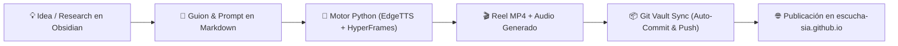

# 🎙️ Centro de Mando Editorial sIA Media & Podcasts

Bienvenido al Vault interactivo de **sIA**. Todo este espacio está conectado directamente con el repositorio de Git en GitHub (`escucha-sia.github.io`).

---

## ⚡ Flujo de Trabajo en Obsidian con Git Vault Sync

---

## 🗂️ Estructura del Vault

* **[[00_Dashboard/Dashboard_Editorial|00 · Dashboard Editorial]]:** Vista global, métricas y estado del pipeline.
* **`01_Episodios/`:** Notas maestras de cada episodio del podcast (guion completo, fuentes APA, audio MP3).
* **`02_Reels_Shorts/`:** Fichas de videos verticales 9:16 con reproductor integrado `![[reels/...mp4]]`.
* **`03_Articulos/`:** Ensayos técnicos de divulgación y artículos de fondo.
* **`04_Templates/`:** Plantillas para crear episodios y reels con un solo clic.
* **`05_Canvas/`:** Pizarras visuales de storyboards y mapas mentales.

---

## 🎬 Reels & Shorts Destacados

| Formato | Título | Estado | Nota / Reproductor |
| :--- | :--- | :--- | :--- |
| **Cómic-Pop (Stupy)** | El Mito de la IA y el Código | ✅ Renderizado | [[02_Reels_Shorts/sIA_Reel_Stupy_01_Mito_IA_Codigo\|Ver Reel & Guion]] |
| **Crónicas Tech** | Marc Lore vs. Amazon | ✅ Renderizado | [[02_Reels_Shorts/sIA_Corp_04_Marc_Lore_Amazon\|Ver Reel]] |
| **Crónicas Tech** | Nintendo vs Sony 1991 | ✅ Renderizado | [[02_Reels_Shorts/sIA_Corp_03_Nintendo_Sony\|Ver Reel]] |
| **Crónicas Tech** | Gabe Newell & Valve Steam | ✅ Renderizado | [[02_Reels_Shorts/sIA_Corp_02_Valve_Gabe\|Ver Reel]] |
| **Crónicas Tech** | Jensen Huang en Denny's | ✅ Renderizado | [[02_Reels_Shorts/sIA_Corp_01_NVIDIA_Dennys\|Ver Reel]] |
| **Terror Psicológico** | El Moderador Nocturno | ✅ Renderizado | [[02_Reels_Shorts/sIA_Terror_02_Moderador\|Ver Reel]] |

---

## 🔄 Configuración de Git Vault Sync (Obsidian Git)

1. En Obsidian, abre `Configuración` -> `Community Plugins`.
2. Activa **Community Plugins** y busca **Obsidian Git**.
3. Haz clic en **Instalar** y luego **Habilitar**.
4. En las opciones de **Obsidian Git**:
   * **Vault backup interval (minutes):** `15` (o `10` para guardado continuo).
   * **Auto Backup after file change:** Activar si deseas commit inmediato al editar.
   * **Auto Pull on startup:** Activar (mantiene sincronizado tu equipo con cualquier cambio del servidor).
   * **Commit message:** `vault backup: {{date}} {{time}}`.
